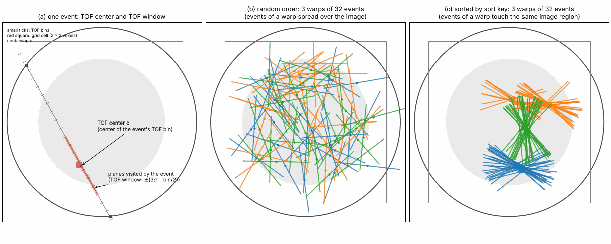
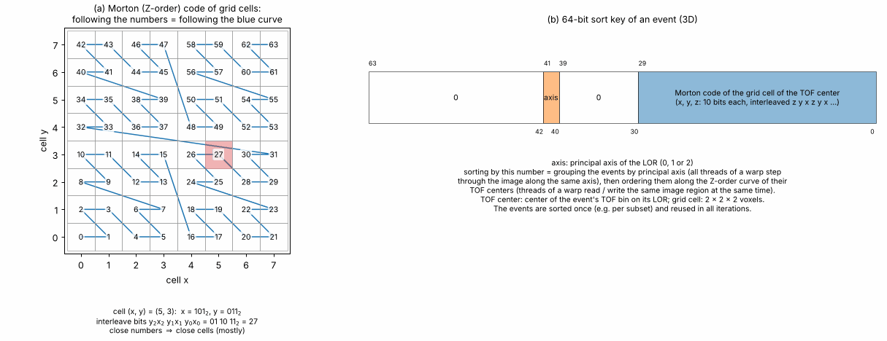

Performance: data order and image layout
========================================

On GPUs, the speed of the sinogram projectors depends strongly on the order of the LORs in
memory and on the memory layout of the image. Both are chosen by the caller: the projectors
accept LORs in any order and C-ordered images with any assignment of the scanner axes to the
image axes. With an unfavorable combination, projections can be several times slower.

Why the order matters
---------------------

Every GPU thread projects one LOR, and 32 consecutive LORs (a *warp*) are processed together.
Image memory accesses of neighboring threads that hit nearby addresses are served by the same
cache lines - for the reads of the forward projection as well as for the atomic additions of
the back projection.

If the **planes (ring pairs) are the fastest varying axis of the sinogram**, consecutive LORs
share the same view and radial position: they follow the same path through the transaxial
image plane and differ only in the axial direction. If, in addition, the **axial direction is
the fastest varying (last) axis of the image** (shape ``(nx, ny, nz)``), these threads access
neighboring voxels in memory at the same time.

Measurements
------------

TOF sinogram of ~1/28 of the LORs of a SIGNA PET/MR-like scanner (5.5 M LORs, 27 TOF bins of
169 ps, CTR 400 ps), image 256 x 256 x 89 with voxels of 2.34 x 2.34 x 2.78 mm, measured on a
desktop NVIDIA GPU with ``scripts/benchmark_tof_sinogram.py`` (times in seconds, best of 3):

.. csv-table::
   :header: "LOR order (slowest to fastest)", "axial image axis", "non-TOF fwd", "non-TOF back", "TOF fwd"
   :widths: 30, 20, 15, 15, 15

   "RVP (radial, view, plane)", "last (2)", "**0.010**", "**0.083**", "**0.057**"
   "VRP (view, radial, plane)", "last (2)", "0.011", "0.098", "0.059"
   "PVR (plane, view, radial)", "first (0)", "0.021", "0.131", "0.065"
   "PVR (plane, view, radial)", "last (2)", "0.052", "0.557", "0.080"
   "RVP (radial, view, plane)", "first (0)", "0.149", "0.527", "0.134"
   "VRP (view, radial, plane)", "first (0)", "0.220", "0.717", "0.130"

The TOF back projection shows the same pattern. Between the fastest and the slowest
combination there is a factor of ~20 (non-TOF forward) and ~9 (non-TOF back projection).
On CPUs, the effect is much smaller. The same effect was reported for parallelproj v1 in
`Schramm & Thielemans (2024), Fig. 3 <https://arxiv.org/abs/2212.12519>`_.

Recommendations
---------------

* Use a sinogram order with the **planes fastest** (e.g. RVP or VRP) together with the
  **axial direction as the last image axis**. This is the default of `parallelproj`.
* With data in an order where the radial bins are fastest (e.g. PVR, used by STIR), either
  reorder the sinogram once (a transpose costs much less than a projection), or use the
  axial direction as the *first* image axis. PVR with the axial direction as the last image
  axis is the slowest of the common combinations.
* For listmode data, the event order matters even more: sort the events once with
  :func:`parallelproj_core.tof_lm_sort_key`, see :ref:`listmode-event-order` below.
* To check a setup, run the benchmark with ``--lor_order`` and ``--axial_axis``, e.g.

  .. code-block:: bash

     python scripts/benchmark_tof_sinogram.py --device cuda:0 --preset signa --lor_order PVR --axial_axis 0

.. _listmode-event-order:

Listmode: the order of the events matters
-----------------------------------------

The TOF listmode projectors (:func:`parallelproj_core.joseph3d_tof_lm_fwd`,
:func:`parallelproj_core.joseph3d_tof_lm_back` and their ``_tab`` versions) use one GPU
thread per event, and 32 consecutive events (a warp) are processed together. Each event
reads (forward) or writes (back projection) the voxels along a short piece of its LOR: the
image planes of its TOF window around its **TOF center**, the center of the event's TOF bin
on the LOR (panel a below).

Listmode data are usually stored in time order, i.e. the events of a warp lie anywhere in
the image (panel b). Then almost every voxel access of a warp needs its own memory
transaction - the image does not fit into the GPU caches - and the projectors are limited by
memory accesses: per image plane, they were 4x (forward) to 12x (back projection) slower
than the TOF sinogram projectors. If consecutive events have nearby TOF centers (panel c),
the threads of a warp access the same image region at the same time, and the voxels come
from the caches.

   \(a) TOF center of an event and the planes its projection visits (TOF window).
   (b) Three warps of 32 consecutive events in random (time) order and (c) after sorting
   the events by their sort key. 2D illustration (one transaxial plane).

**The sort key.** :func:`parallelproj_core.tof_lm_sort_key` computes a 64-bit integer for
every event: the principal axis of its LOR (bits 40-41; all threads of a warp then step
through the image along the same axis) and the 3D **Morton code** (Z-order code) of the grid
cell of 2 x 2 x 2 voxels that contains its TOF center (bits 0-29). The Morton code
interleaves the bits of the cell coordinates; cells with close codes are (mostly) close in
space, in all three directions at once. Sorting the events by the key orders them by
principal axis and then along the Z-shaped curve through the grid cells.

   \(a) Morton code of the cells of a 2D grid: following the numbers means following the
   blue curve. (b) Bit layout of the 64-bit sort key.

**Usage.** Sort the events once - e.g. once per subset, before the iterations of a
reconstruction - and use the sorted events in all projections. The order of the events does
not change their projections (forward: the same values in the new order; back projection:
the same image up to the rounding of the summation order). In listmode MLEM / OSEM, only
the per-event arrays have to be reordered consistently (LOR end points, TOF bins, per-event
TOF parameters, corrections such as attenuation, normalization or contamination):

.. code-block:: python

   key = xp.zeros(num_events, dtype=xp.int64, device=dev)
   parallelproj_core.tof_lm_sort_key(event_start, event_end, image_origin, voxel_size, key,
                                     tof_bin_width, tof_center_offset, tof_bin_index,
                                     num_tof_bins)
   order = xp.argsort(key)
   event_start, event_end = event_start[order, :], event_end[order, :]
   tof_bin_index = tof_bin_index[order]   # ... and all other per-event arrays

**Measurements.** 10 M events of a cylinder phantom (SIGNA-like geometry, image
256 x 256 x 89, 27 TOF bins of 169 ps, CTR 400 ps, 3 sigma), NVIDIA RTX A4500,
``scripts/benchmark_tof_listmode.py`` (times in seconds, best of 3):

.. csv-table::
   :header: "event order", "fwd", "back", "speed-up fwd", "speed-up back"
   :widths: 40, 12, 12, 18, 18

   "random (time order)", "0.162", "0.565", "1.0", "1.0"
   "by LOR (sinogram order), then TOF bin", "0.033", "0.171", "4.9", "3.3"
   "principal axis, then TOF center along it [#cui]_", "0.040", "0.249", "4.1", "2.3"
   "**sort key** (principal axis, Morton code)", "**0.019**", "**0.064**", "**8.5**", "**8.8**"

With sorted events, the listmode projectors are as fast per image plane as the TOF sinogram
projectors (forward: faster). Computing the keys and sorting took 0.03 s for 10 M events
on the same GPU, which is less than the time saved by a single forward projection. Sorting
in every projector call instead (key, sort, reorder, project) would still be 3x (forward) /
6x (back) faster than unsorted events, but sorting once is another 3x / 1.5x faster. With
narrow TOF bins (sigma / 5), the speed-ups are the same (8.3x / 8.6x). On CPUs the effect is
smaller: on a 4-core CPU (1 M events), the forward projection was about as fast as before
and the back projection ~1.5x faster after sorting. Grid cells of 1 to 4
voxels perform equally; additional direction bins in the key helped the forward projection
by ~5 % but slowed the back projection down, so they are not used.

.. [#cui] As proposed by Cui, Pratx, Prevrhal and Levin, "Fully 3D list-mode time-of-flight
   PET image reconstruction on GPUs using CUDA", Med. Phys. 38 (2011) 6775-6786.
