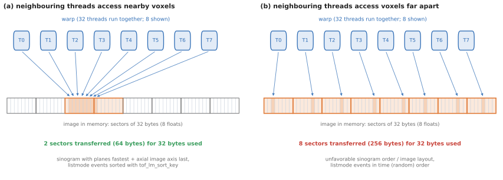
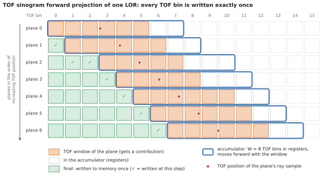
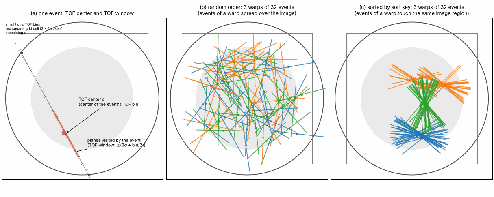
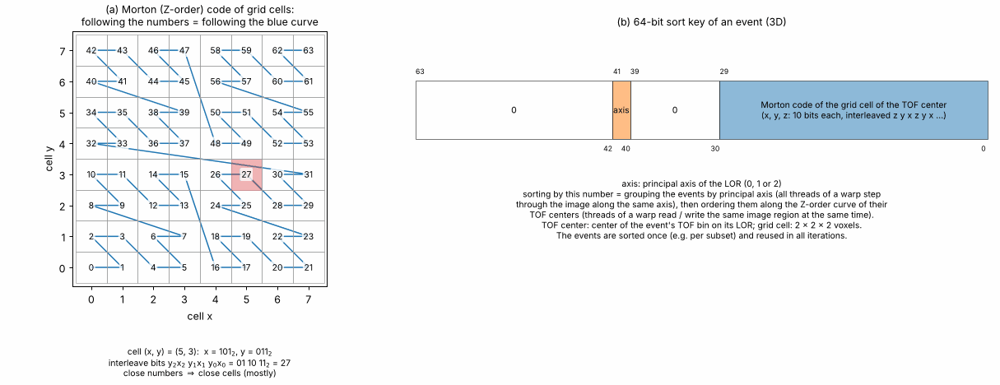

Implementation on GPUs
======================

This page explains the main techniques that make the projectors fast, in particular on GPUs.
It is not needed to *use* the library, but it explains the performance recommendations
(:doc:`/performance`) and is a starting point for developers. Numbers are from a desktop GPU
(NVIDIA RTX A4500) and a SIGNA-like geometry.

How GPUs run the projectors
---------------------------

* **One thread per LOR (or event).** Every GPU thread projects one LOR, sample by sample. The
  same C++ code ("worker") is used by the CPU (OpenMP loop over the LORs) and the GPU (CUDA
  kernel), so both give the same results.
* **Warps.** 32 neighbouring threads (a *warp*) run in lock step. If they take different code
  paths or need different amounts of work, the warp waits for the slowest thread.
* **Memory transactions.** The image (e.g. 256 × 256 × 89 floats = 23 MB) lives in GPU memory
  and does not fit into the caches (a few MB). Memory is transferred in *sectors* of 32 bytes
  (8 floats): when the threads of a warp read or add to nearby voxels, few sectors are needed
  and all their bytes are used; when they access voxels far apart, every thread needs its own
  sector and most transferred bytes are wasted.

   Memory transactions of a warp (8 of 32 threads shown). (a) Neighbouring threads access
   nearby voxels: 2 sectors. (b) Neighbouring threads access voxels far apart: one sector per
   thread.

The projectors do little arithmetic per voxel access, so **memory access patterns decide the
speed**. Two consequences for users:

* **Sinograms:** order the LORs such that neighbouring LORs run through the image side by side
  (planes fastest), and store the axial direction as the last image axis. This can make a
  factor of up to ~20 (:doc:`/performance`).
* **Listmode:** sort the events once by their TOF center (``tof_lm_sort_key``), see
  :ref:`below <lm-sorting>`: ~9x faster.

TOF sinogram projectors: a sliding window in registers
------------------------------------------------------

A TOF sinogram projection computes all TOF bins of a LOR. A straightforward implementation
adds, for every sample, its contribution directly to the TOF bins of its window in GPU
memory: every TOF bin is read and written many times (once per sample whose window contains
it). ``libparallelproj`` instead keeps the TOF bins that are currently "in use" in
**registers**, the fastest memory of a GPU thread:

   The sliding window for one LOR. (a) Forward projection: the planes are visited in the order
   of increasing TOF position; the accumulator moves forward with the TOF window, and a bin
   that leaves it is final and written to memory exactly once. (b) Back projection (the
   mirror image): every TOF bin is loaded exactly once into the buffer.

1. **Planes in TOF order.** The planes of a LOR are visited in the order of increasing TOF
   position (forwards or backwards along the principal axis), so the TOF window only moves
   forward.
2. **Accumulator.** The forward projection adds the contributions of a sample to an array of
   W TOF bins in registers (the accumulator). When the window has moved on, the first bins of
   the accumulator are final: they are written to memory (once) and the accumulator moves
   forward.
3. **Back projection.** The mirror image: TOF bins are loaded once into a buffer of W bins in
   registers; every sample computes the TOF-weighted sum of its window from the buffer and
   back projects it into the image.

**Why templates and "size classes"?** An array is only kept in registers if its size is known
when the code is compiled and all accesses use compile-time indices (unrolled loops). The
workers are therefore C++ templates in W, compiled for W = 8, 12, 16, 20, 24, 32, 40, 48 and
64 TOF bins. Every LOR uses the smallest W that holds its largest TOF window (which depends on
its σ, so LOR-dependent TOF resolutions are possible). On the GPU, the projector launches one
kernel per size class; every thread first computes the class of its LOR and returns
immediately if it belongs to another launch. This avoids reading σ on the host (which would
force the CPU to wait for the GPU) and costs < 1 %.

**Groups of 4 TOF bins.** If the TOF bins are narrow compared to the voxels (smallest voxel ≥
0.4 TOF bins), the window moves several bins per plane, and the TOF bins are written / read in
aligned groups of 4 (one 16-byte memory access instead of four).

**Result.** Compared with version 2.0.7, the TOF sinogram forward projection became 8-17x and
the back projection 2-6x faster on the GPU (about 2-3x on CPUs); for TOF bins of about σ, a TOF
back projection now takes about as long as a non-TOF back projection.

Back projection and atomic additions
------------------------------------

In the back projection, many threads add to the same voxels at the same time. These
additions are *atomic* (the GPU guarantees that no addition is lost), but they are slower than
normal writes and they cannot be combined when neighbouring threads hit different voxels.
The non-TOF and the listmode back projections are therefore 3-8x slower than the forward
projections, and the TOF sinogram back projection is about as slow as the non-TOF one.

.. _lm-sorting:

TOF listmode projectors: sorting the events
-------------------------------------------

For a listmode event, only the planes whose TOF window contains the event's TOF bin are
visited (about :math:`(2 n_\sigma \sigma_\text{TOF} / \Delta + 1) / (c_f / \Delta)` planes, e.g.
~70 instead of ~250). Each event therefore reads or writes only a short piece of its LOR around
its **TOF center** (the center of its TOF bin on the LOR).

Listmode data are stored in time order: consecutive events - and thus the 32 threads of a warp
- lie anywhere in the image, and almost every voxel access needs its own memory transaction.
If the events are sorted such that consecutive events have nearby TOF centers, the threads of
a warp access the same image region. ``tof_lm_sort_key`` computes a 64-bit sort key per event:
the principal axis of the LOR, followed by the 3D **Morton code** (Z-order code) of the grid
cell (2 × 2 × 2 voxels) that contains the TOF center. Sorting the events by this key once (e.g.
per subset) made the TOF listmode projections ~9x faster; computing the keys and sorting 10⁷
events takes ~0.03 s on a GPU.

   \(a) The TOF center of an event and the planes its projection visits. (b) Three warps of 32
   events in random (time) order and (c) after sorting by the sort key.

   \(a) The Morton code of the cells of a 2D grid: cells with close codes are (mostly) close in
   space. (b) Bit layout of the 64-bit sort key.

See :ref:`listmode-event-order` for usage and measurements, and the gallery example "Faster
TOF Listmode Projections by Sorting the Events".

Numerics and reproducibility
----------------------------

* **Single precision.** All computations are done in float32. The positions of the samples
  are computed from the plane index (``i * a + b``) instead of being accumulated from plane to
  plane, so rounding errors do not grow along the LOR.
* **Identical weights in forward and back projection.** The TOF position of a sample is
  computed with explicitly rounded operations on the GPU (no fused multiply-add that the
  compiler could use in one kernel but not in another), so the forward and the back
  projection use bit-identical TOF weights - exact adjointness up to the rounding of the
  summations.
* **Order of atomic additions.** The order in which threads add to a voxel in the back
  projection is not fixed, so back projections can differ between runs at the level of float
  rounding (~10⁻⁷ relative). Forward projections are reproducible. The same holds for the
  order of listmode events: sorting them changes the forward projection only in its order, and
  the back projection only at the level of rounding.
* **CPU vs. GPU.** CPU and GPU use the same code; differences are at the level of float
  rounding.
