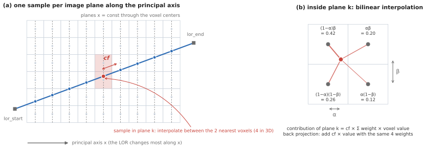

Joseph's method (non-TOF)
=========================

The line integral
-----------------

A LOR runs from :math:`\mathbf{d}_0` (``lor_start``) to :math:`\mathbf{d}_1` (``lor_end``). With
the unit direction :math:`\mathbf{u} = (\mathbf{d}_1 - \mathbf{d}_0) / \|\mathbf{d}_1 - \mathbf{d}_0\|`
and the position :math:`\mathbf{r}(s) = \mathbf{d}_0 + s \, \mathbf{u}` along the LOR, the
(non-TOF) projection of a continuous image :math:`f` is the line integral

.. math::

   p = \int f(\mathbf{r}(s)) \, ds .

For a voxelized image, this integral has to be approximated. Joseph's method
:cite:`Joseph1982` does this by sampling the line once in every image plane along its
principal axis and interpolating the image there.

Sampling planes along the principal axis
----------------------------------------

   \(a) A LOR whose principal axis is x is sampled once in every image plane x = const through
   the voxel centers; cf is the length of the LOR between two planes. (b) Inside a plane, the
   image is interpolated bilinearly between the 4 surrounding voxel centers.

1. **Principal axis.** The principal axis of a LOR is the coordinate axis along which it
   changes the most, i.e. the axis :math:`d` with the largest :math:`|u_d|` (for ties the larger
   axis index). The angle between the LOR and its principal axis is at most 54.7°.
2. **Planes.** The LOR is sampled in the image planes perpendicular to the principal axis that
   pass through the voxel centers (e.g. x = :math:`x_k`, the x coordinates of the voxel
   centers), for all planes between the points where the LOR enters and leaves the image.
3. **Intersection points.** In plane :math:`k`, the LOR is at

   .. math::

      s_k = \frac{x_k - d_{0,x}}{u_x}, \qquad
      \tilde{y}_k = d_{0,y} + s_k u_y, \qquad \tilde{z}_k = d_{0,z} + s_k u_z .

4. **Interpolation.** The image is interpolated bilinearly in the plane at
   :math:`(\tilde{y}_k, \tilde{z}_k)`, i.e. between the 4 voxel centers around the
   intersection point (panel b). Voxels outside the image count as 0.
5. **Weight of a sample.** Every sample stands for the piece of the LOR between two planes,
   whose length is

   .. math::

      c_f = \frac{\Delta_x}{|u_x|} = \frac{\text{voxel size along the principal axis}}{\cos(\text{angle between LOR and principal axis})}

   (``cf`` in the code).

Together:

.. math::

   p \approx c_f \sum_k f_\text{bilinear}(x_k, \tilde{y}_k, \tilde{z}_k) .

Because the planes are always perpendicular to the principal axis, every sample has exactly
4 neighbours, and (for cubic voxels) the step between two samples is never longer than
:math:`\sqrt{3}` voxels.

Back projection
---------------

The back projection is the exact transpose: for every sample, the data value times
:math:`c_f` is distributed to the same 4 voxels with the same 4 bilinear weights. Many LORs
add to the same voxels at the same time, so on GPUs (and with OpenMP) these additions are
*atomic* additions (see :doc:`gpu_implementation`).

Why Joseph's method?
--------------------

Siddon's method :cite:`Siddon1985` computes the exact intersection length of the line with
every voxel it crosses (a piecewise constant image model). Joseph's method interpolates the
image instead (a smoother image model), the number of samples per LOR is fixed by the number
of planes, and every sample touches exactly 4 voxels - which suits GPUs well. The choice of
Joseph's method for parallelproj is discussed in :cite:`Schramm2023`.
