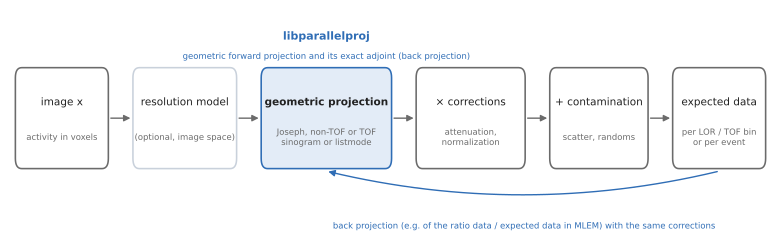

Projectors in PET reconstruction
================================

Forward and back projection
---------------------------

Iterative PET reconstruction compares the measured data with the data expected for the
current image estimate. The core of this comparison is the **(geometric) forward projection**:
for every line of response (LOR) - or every TOF bin of a LOR, or every listmode event - it
sums the image values along the line,

.. math::

   \bar{y}_i = \sum_j a_{ij} \, x_j \qquad \text{or in matrix form} \qquad \bar{y} = A x ,

where :math:`x_j` is the activity in voxel :math:`j` and :math:`a_{ij}` is the contribution of
voxel :math:`j` to LOR (or TOF bin, or event) :math:`i`. :math:`A` is far too large to be
stored; ``libparallelproj`` computes its elements on the fly with Joseph's method
(:doc:`joseph`).

The **back projection** is the multiplication with the transposed (adjoint) matrix,

.. math::

   x^\text{back}_j = \sum_i a_{ij} \, y_i \qquad \text{or} \qquad x^\text{back} = A^T y ,

i.e. every data value is distributed back into the image along its line, with the same
weights. Every reconstruction algorithm needs both operations, e.g. the MLEM update

.. math::

   x^{(n+1)} = \frac{x^{(n)}}{A^T \mathbf{1}} \; A^T \frac{y}{A x^{(n)} + s},

or the gradient of a data fidelity term in a gradient-based method or a neural network.

**Exact adjointness.** The forward and the back projectors of ``libparallelproj`` are exact
adjoints of each other (up to float rounding): for all images :math:`x` and data :math:`y`,

.. math::

   \langle A x, y \rangle = \langle x, A^T y \rangle .

This matters: with a back projector that is only approximately the adjoint, (OS)EM converges
to a different solution, and gradients (e.g. in PyTorch autograd layers) are wrong. The tests
of the library check this for all projectors, and :doc:`practical` shows how to check it for
your own setup.

What the projector models - and what not
----------------------------------------

   A typical PET system model. ``libparallelproj`` computes the geometric projection (and its
   adjoint); everything else is applied by the reconstruction framework.

``libparallelproj`` computes the **geometric** part of the system model: line integrals
through the voxelized image, optionally weighted with the TOF kernel. The other parts of a
realistic system model are applied separately, usually as cheap element-wise operations:

* **attenuation and normalization** (detector efficiencies, geometric effects): multiplicative
  factors per LOR (or event),
* **scatter and randoms**: additive contamination per LOR / TOF bin (or event),
* **resolution modeling** (detector blurring, positron range): e.g. a convolution in image
  space before the projection (and its adjoint after the back projection),
* the **detector response** across the LOR is not modeled: the LOR is an infinitely thin
  line; image-space resolution modeling is the usual remedy.

What a projection value means
-----------------------------

A projection value is a line integral of the image, in units of *image value × length* (the
length unit of the coordinates, e.g. mm). Example: the non-TOF forward projection of an image
that is 1 everywhere is the length of the part of the LOR inside the image. With TOF, this
length is distributed over the TOF bins of the LOR; the TOF bins together give the same total
(:doc:`tof`).

Conventions
-----------

* **Image:** a 3D array of shape ``(n0, n1, n2)`` in C order (the last axis is contiguous in
  memory). ``image_origin`` is the position of the **center** of voxel ``[0, 0, 0]``,
  ``voxel_size`` the voxel size along the three axes; voxel ``[i, j, k]`` is centered at
  ``image_origin + (i, j, k) * voxel_size``. Any assignment of the scanner axes to the image
  axes is possible (see :doc:`/performance` for the fastest layout on GPUs).
* **LORs / events:** ``lor_start`` and ``lor_end`` (shape ``(..., 3)``) are the end points of
  the LORs in the same coordinate system and units as the image. The LOR is the line segment
  between them; the parts outside the image do not contribute.
* **Orientation:** for non-TOF projections, start and end can be swapped. For TOF projections,
  the direction matters: TOF bins are numbered from ``lor_start`` towards ``lor_end``, and a
  positive ``tof_center_offset`` shifts the TOF bins towards ``lor_end`` (:doc:`tof`).

.. csv-table:: Data of the projectors
   :header: "projector", "one value per", "shape of the data"
   :widths: 30, 30, 40

   "non-TOF (``joseph3d_fwd`` / ``_back``)", "LOR", "``lor_start.shape[:-1]``"
   "TOF sinogram (``joseph3d_tof_sino_*``)", "TOF bin of a LOR", "``lor_start.shape[:-1] + (num_tof_bins,)``"
   "TOF listmode (``joseph3d_tof_lm_*``)", "event (LOR + TOF bin ``tof_bin_index``)", "``(num_events,)``"

Non-TOF projections of listmode data use the non-TOF projectors with one "LOR" per event.
