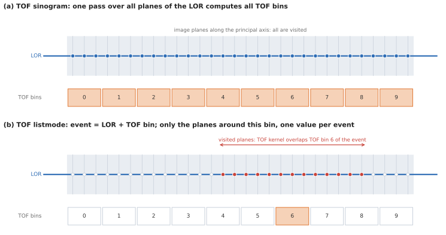
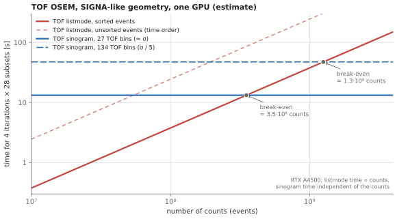

TOF sinogram vs. TOF listmode
=============================

The physics is the same, but TOF data can be stored in two ways, and ``libparallelproj`` has
projectors for both.

* **TOF sinogram:** the counts are histogrammed into all TOF bins of all LORs of the scanner
  (e.g. 351 radial bins × 224 views × 2025 ring pairs × 27 TOF bins for a SIGNA-like scanner).
  The size of the data does not depend on the number of counts.
* **TOF listmode:** every detected coincidence is one event: its LOR (end points) and its TOF
  bin (``tof_bin_index``). The size of the data is proportional to the number of counts.

What the projectors compute
---------------------------

   \(a) TOF sinogram: one pass over all image planes of a LOR computes all its TOF bins.
   (b) TOF listmode: only the planes whose TOF kernel overlaps the event's TOF bin are visited;
   the result is one value per event.

* **TOF sinogram projectors** (``joseph3d_tof_sino_fwd`` / ``_back``) step once through all
  image planes of a LOR and compute (or back project) all its TOF bins at the same time: every
  sample contributes to the TOF bins of its TOF window.
* **TOF listmode projectors** (``joseph3d_tof_lm_fwd`` / ``_back``) compute only the one TOF bin
  of an event. Only the planes whose TOF window contains this bin are visited - a few planes
  around the TOF bin instead of all planes of the LOR.

Both use exactly the same samples and TOF weights: **the listmode projection of an event is
identical to the value of its TOF bin in the TOF sinogram projection** (up to float rounding).
A listmode reconstruction and a sinogram reconstruction of the same data therefore solve the
same problem.

Which one is faster?
--------------------

The cost of a TOF sinogram projection is proportional to the number of LORs (and grows with
the number of TOF bins per sample); the cost of a TOF listmode projection is proportional to
the number of events. For few counts, listmode is faster; for many counts, the sinogram.

   Estimated time of a TOF OSEM reconstruction (4 iterations × 28 subsets) for a SIGNA-like
   scanner on one desktop GPU (NVIDIA RTX A4500), from the benchmarks
   ``scripts/benchmark_tof_sinogram.py`` (one subset of the full sinogram) and
   ``scripts/benchmark_tof_listmode_scaling.py``. The sensitivity image (~1 s, the same for both)
   is not included.

For this example:

.. csv-table::
   :header: "", "per iteration", "break-even"
   :widths: 40, 30, 30

   "TOF sinogram, 27 TOF bins (≈ σ)", "~3.3 s", "≈ 3.5·10⁸ counts"
   "TOF sinogram, 134 TOF bins (σ / 5)", "~11.8 s", "≈ 1.3·10⁹ counts"
   "TOF listmode, sorted events", "~9.4 ns per event", ""
   "TOF listmode, unsorted events", "~61 ns per event", ""

So below a few 10⁸ counts, listmode reconstructions are faster - **if the events are sorted**
(see :doc:`gpu_implementation`); unsorted (time-ordered) events are ~6x slower. The break-even
depends on the scanner, the TOF binning, the image and the GPU; the benchmark scripts can be
used to estimate it for other setups.

**Memory** (to keep everything on the GPU): listmode needs ~30-40 bytes per event (LOR end
points, TOF bin, corrections, one buffer), i.e. ~12 GB for 3·10⁸ events. A TOF sinogram needs
4 bytes per TOF bin for every array (data, contamination, forward projection), i.e. ~17 GB per
array for 27 TOF bins of the full SIGNA sinogram, and ~85 GB for 134 TOF bins.

Other considerations:

* **Sinograms** allow mashing / compression, simple data handling and precomputed corrections
  per bin; their cost is predictable.
* **Listmode** keeps the full information of every event (no binning of LORs or time), allows
  event-wise corrections and motion correction, and is the natural choice for dynamic frames
  with few counts.

The TOF listmode "point" projectors
-----------------------------------

``tof_lm_point_fwd`` / ``tof_lm_point_back`` are a much faster *approximation*: every event is
reduced to a single point, the center of its TOF bin, where the image is interpolated
trilinearly (forward) or the value is splatted (back). There is no ray tracing and no TOF
kernel. Use them for quick looks (e.g. TOF "histo-images" by back projecting events with
value 1), motion detection, inputs of neural networks, or as an approximate projector in
iterative methods.
