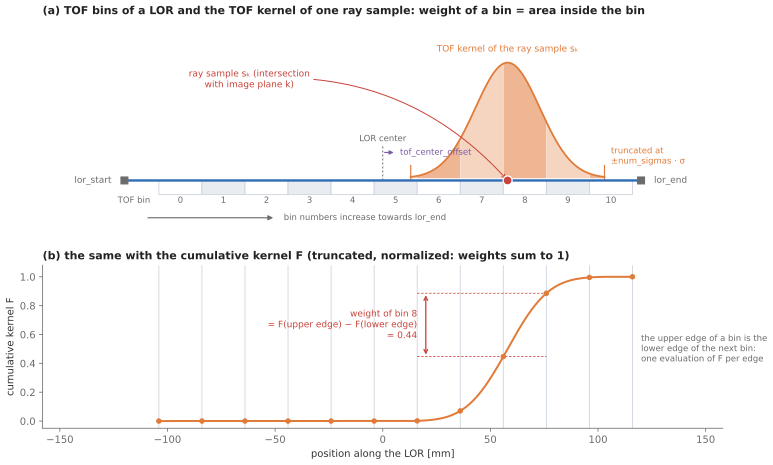
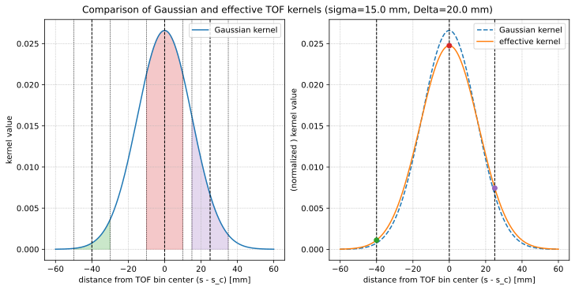

Time of flight (TOF)
====================

The TOF kernel
--------------

With time-of-flight information, the difference of the arrival times of the two photons tells
roughly *where* on the LOR the annihilation happened. Instead of the whole line integral,
a TOF projection weights the image along the LOR with the **TOF kernel**: the probability
density that the TOF measurement places an annihilation at a certain distance from its true
position. Usually this is a Gaussian with standard deviation :math:`\sigma_\text{TOF}`,

.. math::

   g(u) = \frac{1}{\sqrt{2\pi}\,\sigma_\text{TOF}}
          \exp\!\left(-\frac{u^2}{2\sigma_\text{TOF}^2}\right),

where :math:`u` is the distance along the LOR.

.. note::
   **From timing resolution to σ.** A time difference :math:`\Delta t` corresponds to a
   distance of :math:`c \, \Delta t / 2` along the LOR (:math:`c / 2 \approx 0.15` mm/ps). The
   coincidence time resolution (CTR) is usually given as a FWHM, and
   :math:`\sigma = \text{FWHM} / (2\sqrt{2\ln 2}) \approx \text{FWHM} / 2.355`.
   Example: a CTR of 400 ps corresponds to a FWHM of 60 mm and :math:`\sigma_\text{TOF}` = 25.5 mm.

TOF bins
--------

TOF data are binned: the LOR is divided into ``num_tof_bins`` TOF bins of width
:math:`\Delta` (``tof_bin_width``, in spatial units). TOF bin :math:`t` is centered at the
distance

.. math::

   (t - (N - 1) / 2) \, \Delta + o

from the center of the LOR, measured **towards** ``lor_end``, where :math:`N` is the number of
TOF bins and :math:`o` the ``tof_center_offset`` (one value, or one per LOR / event). So TOF
bins are numbered from ``lor_start`` towards ``lor_end``, and the central bin lies at the LOR
center (plus the offset).

   \(a) The TOF bins of a LOR and the truncated TOF kernel around one ray sample: the weight of
   a TOF bin is the area of the kernel inside the bin. (b) The same with the cumulative kernel
   F: the weight of a bin is the difference of F at its two edges.

TOF weights of a ray sample
---------------------------

Joseph's method samples the LOR at the points :math:`s_k` (one per image plane, see
:doc:`joseph`). The TOF sinogram value of TOF bin :math:`t` is

.. math::

   p_t \approx c_f \sum_k w_t(s_k) \; f_\text{bilinear}(\mathbf{r}(s_k)) ,

where :math:`w_t(s_k)` is the **weight of TOF bin t for the ray sample** :math:`s_k`: the
fraction of the TOF kernel centered at :math:`s_k` that falls into the bin, i.e. the integral
of the kernel over the bin (figure, panel a). With the cumulative kernel
:math:`F(u) = \int_{-\infty}^u g(u') \, du'`,

.. math::

   w_t(s_k) = F(e_{t+1} - s_k) - F(e_t - s_k),

where :math:`e_t, e_{t+1}` are the edges of TOF bin :math:`t` (panel b). Neighbouring bins share
an edge, so the weights of :math:`n` neighbouring bins need :math:`n + 1` evaluations of
:math:`F` (one ``erf`` each for the Gaussian).

   The Gaussian TOF kernel and the *effective* kernel of a TOF bin (the Gaussian integrated
   over the bin): the TOF bin width broadens the effective kernel.

Truncation of the TOF kernel
----------------------------

The Gaussian has infinite support, but its tails contribute almost nothing. The projectors
truncate it at ``num_sigmas`` (:math:`n_\sigma`, default 3) standard deviations and
renormalize it:

.. math::

   w_t(s_k) =
   \frac{\Phi(\operatorname{clip}(u_+)) - \Phi(\operatorname{clip}(u_-))}{\Phi(n_\sigma) - \Phi(-n_\sigma)},
   \qquad u_+ = \frac{e_{t+1} - s_k}{\sigma_\text{TOF}}, \quad u_- = \frac{e_t - s_k}{\sigma_\text{TOF}},

with the cumulative standard normal distribution :math:`\Phi` and
:math:`\operatorname{clip}(u) = \min(\max(u, -n_\sigma), n_\sigma)`. Consequences:

* Only the TOF bins that overlap the support :math:`[s_k - n_\sigma\sigma_\text{TOF}, s_k + n_\sigma\sigma_\text{TOF}]`
  of a sample get a non-zero weight (the **TOF window** of the sample) - which makes TOF
  projections cheap: per sample only a few TOF bins, per TOF bin only a few samples.
* The weights of a sample sum to exactly 1. So the **sum over all TOF bins of a TOF sinogram
  projection equals the non-TOF projection**, as long as the TOF bins cover the support of all
  samples.
* The weights are **continuous** in the position of the sample: a TOF bin entering or leaving
  the window starts or ends with weight 0. Tiny rounding differences of positions therefore
  only cause tiny differences of the projections (e.g. between CPU and GPU).
* TOF sinogram and TOF listmode projectors use the same weight for every (sample, TOF bin)
  pair, so **a listmode event gets exactly the value of its TOF sinogram bin**.

**Choosing num_sigmas.** :math:`n_\sigma = 3` keeps 99.7 % of the Gaussian and is sufficient
for most applications. Larger values are slower (more TOF bins per sample, more samples per
TOF bin) and change the results only slightly; smaller values are faster but cut more of the
tails of the kernel.

**Per-LOR TOF parameters.** ``tof_sigma`` and ``tof_center_offset`` can be given once for all
LORs / events or once per LOR / event (e.g. for detector pairs with different timing
resolution or timing offsets).

.. _tof-window-limit:

The 64-bin limit of the TOF window
----------------------------------

The TOF sinogram projectors keep the TOF window of a sample in a small, fixed-size array (in
GPU registers, see :doc:`gpu_implementation`) with room for at most 64 TOF bins
(``parallelproj_core.tof_max_window_bins``, ``PARALLELPROJ_TOF_MAX_WINDOW_BINS`` in C). The
listmode projectors use exactly the same windows. A window only contains TOF bins that exist,
so with a support of :math:`w_\text{s}` TOF bins (Gaussian:
:math:`w_\text{s} = 2 n_\sigma \sigma_\text{TOF} / \Delta`) and :math:`N` TOF bins, a window has
at most

.. math::

   \min\left(\lfloor w_\text{s} \rfloor + 2, \; N\right)

bins. Consequences:

- **With at most 64 TOF bins, the projections are always exact**, however wide the kernel.
- With more than 64 TOF bins and :math:`w_\text{s} \geq 63`, windows are truncated to the 64
  bins around the center of the support and renormalized (the tails of the kernel are cut,
  the projection is an approximation; it stays exactly adjoint and the weights of a sample
  still sum to 1). The Python interface issues a ``UserWarning`` in this case (checked if
  ``tof_sigma`` / the kernel scale are CPU arrays; reading GPU arrays would force a
  synchronization).
- In practice, TOF bins are chosen as wide as possible while still sampling the kernel well;
  e.g. a 70 cm field of view with 76 ps TOF bins has about 61 bins, and the double-Gaussian
  kernels of BGO detectors with Cherenkov light need windows of about 20-46 bins.

Tabulated (non-Gaussian) TOF kernels
------------------------------------

The projectors with the suffix ``_tab`` (e.g. ``joseph3d_tof_sino_fwd_tab``) use an arbitrary,
possibly asymmetric TOF kernel instead of the Gaussian, e.g. a kernel measured for a detector
pair. The kernel is given as a table of its **cumulative distribution** :math:`F(u)`, where
:math:`u` is measured **in spatial units** (the units of ``lor_start``) and is **positive
towards** ``lor_end``. The table holds :math:`F` at :math:`n` uniformly spaced points from
:math:`u_\text{min}` to :math:`u_\text{max}`:

.. math::

   \texttt{tof_kernel_cdf}[k] = F\!\left(u_\text{min} + k \, \frac{u_\text{max} - u_\text{min}}{n - 1}\right), \quad k = 0, \dots, n - 1 ,

interpolated linearly in between (a piecewise constant kernel). :math:`[u_\text{min}, u_\text{max}]`
is the support of the kernel (:math:`F` is held constant outside); :math:`F` must not decrease
and is normalized by :math:`F(u_\text{max}) - F(u_\text{min})`.

**From arrival time differences to u.** With :math:`\Delta t = t_\text{start} - t_\text{end}`
(arrival time at the detector at ``lor_start`` minus arrival time at the detector at
``lor_end``),

.. math::

   u = \frac{c \, \Delta t}{2} \approx 0.1499 \, \frac{\text{mm}}{\text{ps}} \, \Delta t .

An annihilation closer to the end detector reaches it earlier, so :math:`\Delta t > 0` and
:math:`u > 0`. If a LOR is stored with start and end swapped, the same detector pair needs the
mirrored kernel :math:`F'(u) = 1 - F(-u)` (for a normalized :math:`F`), on the grid from
:math:`-u_\text{max}` to :math:`-u_\text{min}`.

**From a measured histogram to the table.** For a histogram of :math:`\Delta t` (e.g. of a point
source at a known position), the cumulative sum of the counts is :math:`F` at the histogram bin
edges (starting with 0 at the first edge); converting the edges to :math:`u` gives
:math:`u_\text{min}`, :math:`u_\text{max}` and the table directly. See the gallery example
"TOF Projections with a Tabulated (Non-Gaussian) TOF Kernel".

**Bin weights.** As for the Gaussian, the weight of a TOF bin is the integral of the kernel over
the bin, :math:`w_t = (F_s(e_{t+1} - s_k) - F_s(e_t - s_k)) / (F(u_\text{max}) - F(u_\text{min}))`
with :math:`F_s(u) = F(u / s)`. The **TOF bin width is not part of the table** - the projector
integrates over each bin - so the same table works for every TOF binning.

**Kernel scale.** ``tof_kernel_scale`` :math:`s > 0` (one value, or one per LOR / event)
stretches the kernel around :math:`u = 0` (the true position): :math:`s = 1` uses the kernel as
tabulated, :math:`s = 1.5` the same shape 50 % wider, with support
:math:`[s \, u_\text{min}, s \, u_\text{max}]`. The TOF center offset is a separate shift and is
not scaled.

The 64-bin limit applies with the support :math:`w_\text{s} = s \, (u_\text{max} - u_\text{min}) / \Delta`
TOF bins: trim empty tails of a measured kernel from the table.
