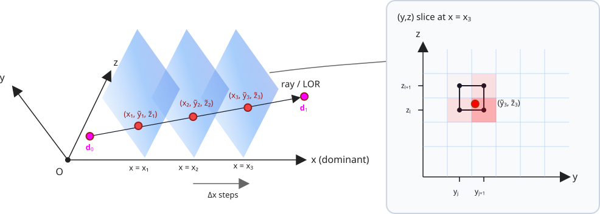
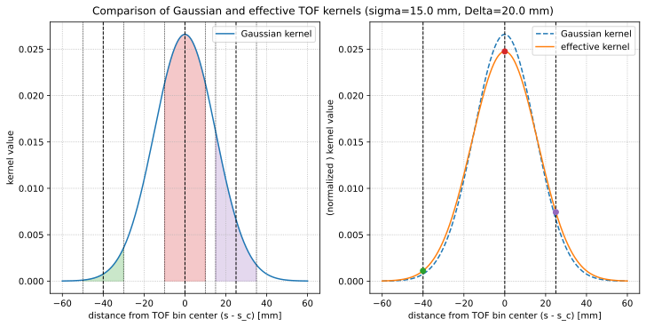

.. _theory_background:

Theory and background
=====================

This page summarizes the core ideas behind the (TOF-weighted) line integrals implemented in
``libparallelproj``. The goal is to provide a compact reference for users of the library.

Line integrals (in 3D)
----------------------

We consider a continuous image/object :math:`f(\mathbf{r})` with :math:`\mathbf{r}=(x,y,z)`.
A line of response (LOR) is defined by two detector points
:math:`\mathbf{d}_0` and :math:`\mathbf{d}_1`. Its length is :math:`L=\|\mathbf{d}_1-\mathbf{d}_0\|` and the
unit direction vector is :math:`\mathbf{u} = (\mathbf{d}_1-\mathbf{d}_0)/L`.

A convenient parameterization along the LOR is

.. math::

   \mathbf{r}(s) = \mathbf{d}_0 + s\,\mathbf{u},
   \qquad s \in [0, L].

The (continuous) non-TOF projection value along the LOR is

.. math::

   p = \int_0^L f(\mathbf{r}(s)) \, ds.

In a voxelized image, this becomes a weighted sum over voxels, where the weights approximate the
path length contribution through each voxel and the voxel values are sampled/interpolated.

Joseph’s method
---------------

Joseph’s method :cite:`Joseph1982`  approximates the line integral by sampling the ray on a sequence of planes
orthogonal to the dominant direction and interpolating in the transverse plane.

Without loss of generality, assume **x is the dominant direction**, i.e.

.. math::

   |u_x| \ge |u_y| \quad \text{and} \quad |u_x| \ge |u_z|.

Sampling planes
^^^^^^^^^^^^^^^

Let :math:`\{x_k\}_{k=1}^n` be the x-coordinates of the sampling planes, typically chosen as the
x-coordinates of voxel centers that lie between the entry and exit points of the ray through the
image bounding box.

For each plane :math:`x=x_k`, compute the corresponding ray parameter :math:`s_k`:

.. math::

   s_k = \frac{x_k - x_0}{u_x},

and then the continuous intersection point in y and z:

.. math::

   \tilde{y}_k = y_0 + s_k u_y, \qquad
   \tilde{z}_k = z_0 + s_k u_z.

These are the (continuous) transverse coordinates of the ray where it intersects the plane
:math:`x=x_k`.

With a constant step in x (the voxel size in x), the path-length increment is

.. math::

   \Delta s = \frac{\Delta_x}{|u_x|}.

Joseph’s method then approximates the line integral as

.. math::

   p \approx \sum_{k=1}^{n} f(x_k,\tilde{y}_k,\tilde{z}_k)\,\Delta s.

where :math:`(\tilde{y}_k,\tilde{z}_k)` are the continuous intersection coordinates and
:math:`f(x_k,\tilde{y}_k,\tilde{z}_k)` is evaluated via bilinear interpolation in :math:`(y,z)`.

TOF-weighted line integrals
---------------------------

Time-of-flight (TOF) information assigns a **weight along the LOR** depending on where the emission
is likely to have occurred.
Typically this can be modeled as a Gaussian along the LOR coordinate :math:`s`
(or an equivalent centered coordinate).

.. note::
  1. The coincidence time resolution (CTR) of PET scanners is often specified in time units (e.g. ps), but it can be converted to distance units along the LOR by multiplying with :math:`c/2` (where :math:`c` is the speed of light).

  2. Knowing that :math:`c` is approximately 0.3 mm/ps, a :math:`\sigma` of 100 ps corresponds to 15 mm along the LOR.

  3. The CTR of PET scanners is often specified as a full-width at half maximum (FWHM) value, which can be converted to :math:`\sigma` via :math:`\sigma = \text{FWHM} / (2\sqrt{2\ln(2)}) \approx \text{FWHM} / 2.355`.

Continuous Gaussian TOF kernel
^^^^^^^^^^^^^^^^^^^^^^^^^^^^^^

Let :math:`\sigma_\text{TOF}` be the TOF standard deviation *in distance units along the LOR* (often derived
from the system CTR). The ideal (continuous) Gaussian kernel centered at :math:`s_c` is

.. math::

   g(s; s_c, \sigma_\text{TOF})
   = \frac{1}{\sqrt{2\pi}\sigma_\text{TOF}}\exp\!\left(-\frac{(s-s_c)^2}{2\sigma_\text{TOF}^2}\right).

The corresponding TOF-weighted line integral is

.. math::

   p_{\text{TOF}}(s_c, \sigma_\text{TOF})
   = \int_0^L f(\mathbf{r}(s))\; g\!\left(s;\, s_c, \sigma_\text{TOF}\right)\, ds.

Finite TOF bin width and the effective TOF kernel
^^^^^^^^^^^^^^^^^^^^^^^^^^^^^^^^^^^^^^^^^^^^^^^^^

In practice, TOF data are binned (due to the use of TDCs), which is equivalent to subdividing the LOR into discrete segments.
A TOF bin has a finite width :math:`\Delta` (in distance units along
the LOR, after converting from time), and one typically wants the probability mass **integrated over
the bin**.

If a bin is centered at :math:`s_c` spans :math:`[s_c-\Delta/2,\, s_c+\Delta/2]`, then an
effective (binned) kernel can be defined as the Gaussian convolved with a rectangular window, or
equivalently as the Gaussian **integrated over the bin limits**.

For a continuous Gaussian kernel, this results in an effective TOF kernel of the form

.. math::

   w_{\text{eff}}(s; s_c, \sigma_\text{TOF}, \Delta)
   = \int_{s_c-\Delta/2}^{s_c+\Delta/2} g(\xi; s_c, \sigma_\text{TOF})\, d\xi
   = \frac{1}{2}\left[
       \operatorname{erf}\!\left(\frac{s - (s_c-\Delta/2)}{\sqrt{2}\sigma_\text{TOF}}\right)
       - \operatorname{erf}\!\left(\frac{s - (s_c+\Delta/2)}{\sqrt{2}\sigma_\text{TOF}}\right)
     \right].

This :math:`w_{\text{eff}}` is dimensionless and represents the fraction of the Gaussian mass that
falls into the TOF bin.

With Joseph sampling points :math:`s_k` along the LOR, the TOF projection for a given LOR and TOF bin center :math:`s_c` is approximated as

.. math::

   p_{\text{TOF}}(s_c)
   \approx \sum_k f(\mathbf{r}(s_k))\; w_{\text{eff}}(s_k; s_c, \sigma_\text{TOF}, \Delta)\; \Delta s.

.. note::
  If the continuous kernel is non-Gaussian, the effective kernel can be defined similarly by integrating the continuous kernel over the TOF bin limits.

TOF projections: sinogram vs listmode
-------------------------------------

Although the underlying physics is the same, the evaluation of TOF projections
is implemented differently for TOF sinogram and TOF listmode data, to increase efficiency.

TOF sinogram
^^^^^^^^^^^^

When dealing with TOF sinograms, we are typically interested in computing projections / backprojections
for all TOF bins of a given LOR,
which allows for efficient reuse of the ray samples when
stepping through the planes in the dominant direction.

For given interpolated image values along the ray :math:`f(\mathbf{r}(s_k))`,
we evaluate the effective TOF weights for "all" TOF bins.

TOF listmode
^^^^^^^^^^^^

When operating in listmode (event-by-event reconstruction), we are typically only interested
in the projection value for a certain single TOF bin for a given LOR (the TOF bin of a given event, detected on a given LOR).

In this case, we only evaluate the effective TOF weights for the relevant TOF bin center :math:`s_c` and ignore the others.

Moreover, based on the width of the (effective) TOF kernel, we can further ignore ray samples that are far from the TOF bin center,
which leads to a significant speedup (see next section).

Truncation of the Gaussian TOF kernel
-------------------------------------

The continuous Gaussian as well as the effective TOF kernel (:math:`w_{\text{eff}}`) have infinite support,
but in practice its tails contribute negligibly far from the center and are expensive to evaluate.

We therefore truncate the **continuous** Gaussian kernel at a configurable number of standard
deviations :math:`n_\sigma` (``num_sigmas``), i.e. we use the truncated kernel

.. math::

   g_\text{trunc}(s; s_c, \sigma_\text{TOF}) \propto
   \begin{cases}
     g(s; s_c, \sigma_\text{TOF}) & |s - s_c| \le n_\sigma \, \sigma_\text{TOF} \\
     0 & \text{otherwise,}
   \end{cases}

normalized to unit integral. The effective TOF weight of a bin is the integral of the truncated
kernel over the bin limits. With the cumulative Gaussian :math:`\Phi` this reads

.. math::

   w_{\text{eff}}(s_k; s_c, \sigma_\text{TOF}, \Delta) =
   \frac{\Phi(\min(\max(u_+, -n_\sigma), n_\sigma)) - \Phi(\min(\max(u_-, -n_\sigma), n_\sigma))}{\Phi(n_\sigma) - \Phi(-n_\sigma)},
   \qquad u_\pm = \frac{s_c \pm \Delta/2 - s_k}{\sigma_\text{TOF}},

i.e. the cumulative kernel is held constant outside the support. Properties:

- only TOF bins that overlap the support :math:`[s_k - n_\sigma \sigma_\text{TOF}, s_k + n_\sigma \sigma_\text{TOF}]`
  of a ray sample get a non-zero weight (in sinogram mode, at most
  :math:`\lfloor 2 n_\sigma \sigma_\text{TOF} / \Delta \rfloor + 2` bins per ray sample),
- the weights of all these bins sum to exactly 1, so the sum over all TOF bins of a TOF sinogram
  projection equals the non-TOF projection (as long as the TOF bins cover the support),
- the weights are **continuous** in the position of the ray sample: a TOF bin entering or leaving
  the support starts or ends with weight 0 (no jumps, so tiny rounding differences of the
  positions cause only tiny differences of the projections),
- sinogram and listmode projectors use the same weight for every (ray sample, TOF bin) pair, so a
  listmode event gets exactly the value of its TOF sinogram bin.

Implementation-wise, this means that

1. in sinogram mode, at a given ray sample :math:`s_k`, we only evaluate the weights of the TOF bins
   overlapping the support around :math:`s_k`; neighbouring bins share an evaluation of
   :math:`\Phi` at their common bin edge.

2. in listmode, we only visit ray samples :math:`s_k` whose support overlaps the TOF bin of the event.

.. important::

  1. The choice of :math:`n_\sigma` is a trade-off between accuracy and speed. A smaller :math:`n_\sigma` leads to faster computations but changes the shape of the kernel (the truncated tails are missing). The default value :math:`n_\sigma=3` (99.7 % of the Gaussian mass) is typically sufficient for most applications.

  2. In sinogram mode, TOF windows of more than 64 TOF bins (:math:`2 n_\sigma \sigma_\text{TOF} / \Delta \gtrsim 62`) are additionally truncated to the 64 bins centered on the ray sample and renormalized. Use wider TOF bins (or a smaller :math:`n_\sigma`) in that case.

Tabulated (non-Gaussian) TOF kernels
------------------------------------

The projectors with the suffix ``_tab`` (e.g. ``joseph3d_tof_sino_fwd_tab``) use an arbitrary,
possibly asymmetric TOF kernel instead of the Gaussian, e.g. a kernel measured for a detector
pair. The kernel is given as a table of its **cumulative distribution**

.. math::

   F(u) = \int_{-\infty}^{u} f(u') \, du' ,

where :math:`f(u)` is the probability density that the TOF measurement places an annihilation
at distance :math:`u` from its true position on the LOR. :math:`u` is measured **in spatial
units** (the units of ``lor_start`` and ``lor_end``, e.g. mm) and is **positive towards the end
point of the LOR**.

The table holds :math:`F` at :math:`n` uniformly spaced points from :math:`u_\text{min}` to
:math:`u_\text{max}`:

.. math::

   \texttt{tof_kernel_cdf}[k] = F\!\left(u_\text{min} + k \, \frac{u_\text{max} - u_\text{min}}{n - 1}\right), \quad k = 0, \dots, n - 1 ,

and :math:`F` is interpolated linearly between the table points (which corresponds to a
piecewise constant kernel :math:`f`). :math:`[u_\text{min}, u_\text{max}]` is the support of the
kernel: :math:`F` is held constant outside. :math:`F` must not decrease; it does not need to
start at 0 or end at 1, since the weights are normalized by :math:`F(u_\text{max}) - F(u_\text{min})`.

**From arrival time differences to u.** Timing measurements give the difference of the arrival
times of the two photons. With :math:`\Delta t = t_\text{start} - t_\text{end}` (arrival time at
the detector at ``lor_start`` minus arrival time at the detector at ``lor_end``),

.. math::

   u = \frac{c \, \Delta t}{2} \approx 0.1499 \, \frac{\text{mm}}{\text{ps}} \, \Delta t .

An annihilation closer to the end detector reaches it earlier, so :math:`\Delta t > 0` and
:math:`u > 0`. If a LOR is stored with start and end swapped, the same detector pair needs the
mirrored kernel :math:`F'(u) = 1 - F(-u)` (for a normalized :math:`F`), on the grid from
:math:`-u_\text{max}` to :math:`-u_\text{min}`.

**From a measured histogram to the table.** For a histogram of :math:`\Delta t` (e.g. of a point
source at a known position), the cumulative sum of the counts is :math:`F` at the histogram bin
edges (starting with 0 at the first edge); converting the edges to :math:`u` gives
:math:`u_\text{min}`, :math:`u_\text{max}` and the table directly. Linear interpolation of this
table is exactly the histogram as density. See the gallery example
"TOF Projections with a Tabulated (Non-Gaussian) TOF Kernel".

**Bin weights.** As for the Gaussian, the weight of a TOF bin with edges :math:`e_k, e_{k+1}`
(along the LOR) for a ray sample at position :math:`p` is the integral of the kernel over the bin:

.. math::

   w_k = \frac{F_s(e_{k+1} - p - o) - F_s(e_k - p - o)}{F(u_\text{max}) - F(u_\text{min})}, \qquad F_s(u) = F(u / s),

where :math:`o` is the TOF center offset of the LOR. The **TOF bin width is not part of the
table** - the projector integrates over each bin - so the same table works for every TOF binning.

**Kernel scale.** ``tof_kernel_scale`` :math:`s > 0` (one value, or one per LOR / event)
stretches the kernel around :math:`u = 0` (the true position): :math:`s = 1` uses the kernel as
tabulated, :math:`s = 1.5` the same shape 50 % wider, with support
:math:`[s \, u_\text{min}, s \, u_\text{max}]`. The TOF center offset is a separate shift and is
not scaled. (For an asymmetric kernel whose mean is not 0, the mean moves with :math:`s`.)

.. important::

  The projectors handle TOF windows of up to 64 TOF bins. If the support
  :math:`s \, (u_\text{max} - u_\text{min})` is wider than about 62 TOF bin widths, the window
  is truncated to 64 bins around the center of the support and renormalized, which cuts off
  parts of the kernel. Trim empty tails of a measured kernel from the table.

Math symbols vs C API variable names
------------------------------------

.. csv-table::
   :header: "Symbol in theory/background", "Meaning", "API variable name"
   :widths: 30, 35, 35

   ":math:`\mathbf{d}_0`", "LOR start point", "``lor_start``"
   ":math:`\mathbf{d}_1`", "LOR end point", "``lor_end``"
   ":math:`f(\mathbf{r})`", "(discretized) image", "``image``"
   ":math:`\Delta`", "TOF bin width", "``tof_bin_width``"
   ":math:`\sigma_{\mathrm{TOF}}`", "TOF standard deviation", "``tof_sigma``"
   ":math:`n_\sigma`", "Truncation width in units of :math:`\sigma_{\mathrm{TOF}}`", "``num_sigmas``"
   ":math:`F(u)`", "Cumulative TOF kernel (table, ``_tab`` projectors)", "``tof_kernel_cdf``"
   ":math:`u_\text{min}, u_\text{max}`", "Support of the tabulated kernel (spatial units)", "``tof_kernel_u_min``, ``tof_kernel_u_max``"
   ":math:`s`", "Scale of the tabulated kernel", "``tof_kernel_scale``"
